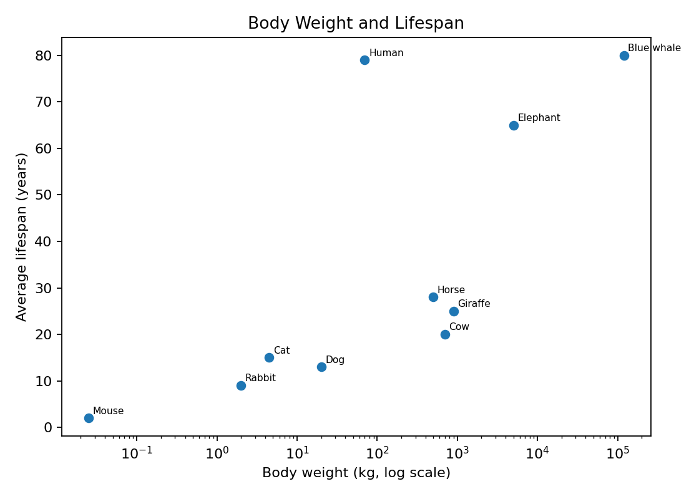
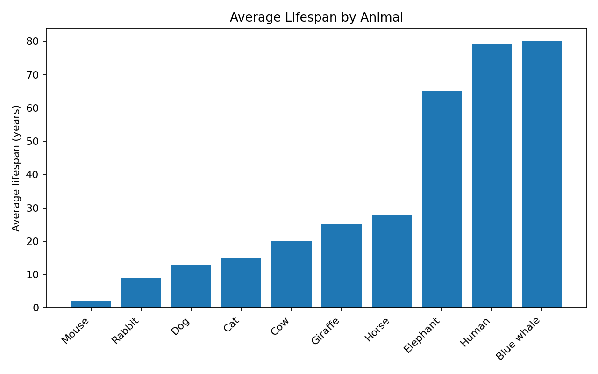

# Do Larger Animals Live Longer?

## About Me
I am a freshman learning how Python can be used to explore a simple dataset.

## My Question
Is animal body weight related to average lifespan?

## My Dataset
This small **practice dataset** contains animal name, approximate body weight (kg), and average lifespan (years). It is provided for learning Python; it is not intended as a research-quality comparative biology dataset.

## Python Tools
- Python
- pandas
- matplotlib

## Results
### Figure 1. Body weight and lifespan


In this small practice dataset, some larger animals have longer lifespans, but body size alone does not explain all differences.

### Figure 2. Lifespan by animal


The animals in the dataset show a wide range of average lifespans.

## Code I Can Explain
### 1. Read a CSV file
```python
df = pd.read_csv('animals.csv')
```
This reads the CSV file and stores the table in a pandas DataFrame called `df`.

### 2. Calculate a mean
```python
df['Lifespan'].mean()
```
This selects the `Lifespan` column and calculates its average.

### 3. Make a scatter plot
```python
plt.scatter(df['Weight'], df['Lifespan'])
```
This plots body weight on the x-axis and lifespan on the y-axis.

## How I Used GenAI
I asked GenAI to explain why a log scale could make body weights easier to visualize. I then checked the code and made sure I could explain what it did.

## What I Learned
I learned how to read a CSV file, calculate a simple summary, create figures, organize a GitHub repository, and explain Python code in my own words.

## Notebook
[Open the Jupyter notebook](notebook/animal_lifespan_project.ipynb)

## Project Demonstration Video
The submitted student repository should also contain an MP4 laptop screen recording demonstrating the project. In the video, briefly show the GitHub README, open/run the notebook, explain the two figures, and explain at least one code block.

Example filename: `video/project_demo.mp4`
